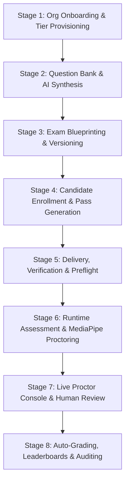
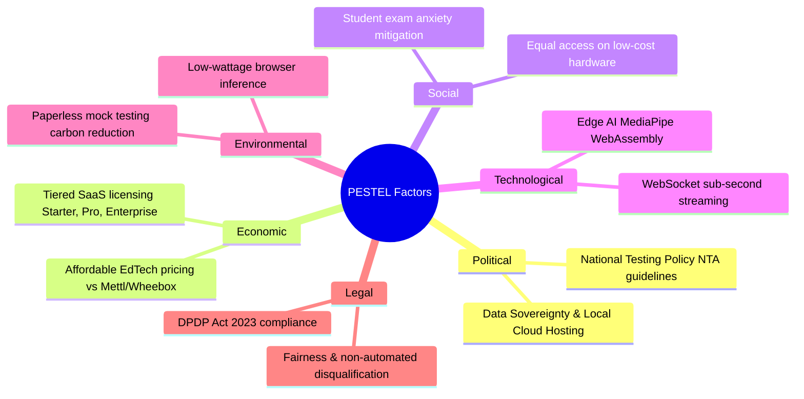

# Lunaris Platform: Comprehensive Lifecycle, Gaps, SWOT, PESTEL & Value Proposition Analysis

**Document Version:** 2.4.0  
**Target Architecture:** Lunaris CBT & Live Proctoring Platform (FastAPI + React 18 + MediaPipe + SQLite/PostgreSQL)  
**Classification:** Strategic Architectural & Lifecycle Audit  
**Date:** October 2026  

---

## Executive Summary

**Lunaris** is an enterprise-grade assessment platform tailored for competitive exams (such as NTA JEE Main/Advanced, NEET, BITSAT), live interactive classroom arenas (Quick Quiz), and self-paced formative testing (Standard Quiz). It integrates on-device computer vision telemetry (Google MediaPipe), WebSockets for sub-second proctor CCTV feeds, automated question synthesis via Google Gemini AI, and an account-free candidate credentialing system (UID + PIN).

This document presents a comprehensive evaluation of the **entire 8-stage assessment lifecycle**, provides a detailed breakdown of **technical and operational gaps**, analyzes the platform via **SWOT** and **PESTEL** frameworks, maps **Pains vs. Gains** across all primary stakeholders, and outlines a prioritized execution roadmap.

---

## 1. End-to-End Platform Lifecycle Analysis



### Stage 1: Organization Onboarding & Tenant Provisioning
* **Current State:** Supports multi-tenant workspaces where an institution registers, creates a workspace with a unique slug and permanent invite key (`ORG-XXXX`), and selects an entitlement tier (`Starter`, `Creator Pro`, `Institution`).
* **Mechanism:** Single database schema with `organization_id` foreign key isolation.
* **Flow:** Owner signs up -> Organization is automatically spawned -> Members (Admins, Exam Authors, Proctors, Candidates) join via invite links or SMTP invitations.

### Stage 2: Question Bank Authoring & AI Studio
* **Current State:** 
  * Manual creation of MCQs and Numerical Value Questions (NVQ with tolerance).
  * AI Question Studio utilizing Google Gemini 1.5/2.0 to generate curriculum-aligned questions (Physics, Chemistry, Mathematics) with step-by-step explanations, distraction analysis, and LaTeX/MathML formulas.
  * Human-in-the-loop review workflow (`Draft` -> `Approved` / `Rejected`).
* **Mechanism:** Central question repository tagged by subject, difficulty, and Bloom's cognitive level.

### Stage 3: Exam Architecture & Blueprinting
* **Current State:**
  * 8-step wizard supporting three distinct assessment modes:
    1. **NTA Proctored CBT:** Strict 3-section JEE pattern with full webcam, microphone, tab focus, and fullscreen lockdown.
    2. **Quick Quiz Arena:** Live gamified Kahoot-style quiz with 6-character room codes, speed bonuses, and real-time leaderboards.
    3. **Standard Practice Quiz:** Self-paced assessment **without camera, microphone, or fullscreen restrictions**.
  * Exam snapshotting: When an exam is published, it creates an immutable `ExamVersion` record so ongoing question bank edits do not invalidate in-flight candidate tests.

### Stage 4: Candidate Enrollment & Credential Distribution
* **Current State:**
  * No permanent student accounts required. Eliminates password fatigue and sign-up drop-offs.
  * Admins batch-generate or manually enroll students with custom/auto UIDs (`LUN-XXXXXX`) and 4-digit PINs.
  * PINs are securely hashed using `bcrypt` for verification while raw plain pins are retained for dynamic export.
  * Automated CSV export with direct magic URLs (`/?mode=candidate&slug=...&uid=...&pin=...`) and live QR code passes.

### Stage 5: Examination Delivery & Preflight Check
* **Current State:**
  * **Proctored CBT Mode:** Preflight forces camera verification (1280x720 @ 30 FPS), microphone amplitude check, browser capability verification, and fullscreen confirmation before unlocking the exam paper.
  * **Standard Quiz Mode:** Bypasses webcam and microphone initialization entirely; displays an open-format notice and enables immediate one-click exam launch without fullscreen locks.

### Stage 6: Secure Exam Runtime & Edge ML Telemetry
* **Current State:**
  * MediaPipe runs in-browser (Face Mesh & Landmarker) detecting face absence, multiple faces, cell phones/prohibited objects, and gaze deviation.
  * Events are streamed to `POST /api/v1/candidate/proctor-event` with timestamped anomaly metadata.
  * Live CCTV binary JPEG frames are streamed over WebSocket (`/ws/cctv/{attempt_id}`) to the backend `stream_hub.py`.
  * Continuous autosave saves answers via `POST /api/v1/candidate/save-answer` with revision monotonicity tracking to prevent out-of-order overrides.

### Stage 7: Proctor Incident Review & Human Moderation
* **Current State:**
  * Real-time grid of live candidate feeds in `LiveProctorDashboard.jsx`.
  * Color-coded incident severity tags (`advisory`, `suspicious`, `high`).
  * Real-time proctor warning dispatch (`send-warning`) that flashes modal notifications directly on the candidate screen.
  * Manual human reviewer decision logging (`Confirmed Violation`, `Dismissed False Positive`).

### Stage 8: Auto-Grading, Analytics & Audit Archival
* **Current State:**
  * Immediate scoring upon candidate submission (+4 for correct, -1 for incorrect, tolerance evaluation for NVQs).
  * Section-wise breakdown (Physics, Chemistry, Mathematics).
  * Leaderboard generation for Quick Quiz mode.
  * Full proctor incident audit trail retention for compliance.

---

## 2. Identified Gaps, Technical Debt & Bugs

| Area | Component | Identified Gap / Bug | Impact | Recommended Solution |
| :--- | :--- | :--- | :--- | :--- |
| **Concurrency & Storage** | `backend/app/core/database.py` | SQLite file locks on Windows NTFS during concurrent candidate writes (CCTV frames + autosaves). | Causes `OperationalError: disk I/O error` under high simultaneous candidate loads (>50). | Migrate production workloads to managed PostgreSQL (RDS / Supabase) with connection pooling (PgBouncer). |
| **Video Scaling** | `backend/app/proctor/stream_hub.py` | MJPEG HTTP streaming with in-memory frame cache. | Consumes high egress bandwidth (~1.5 MB/s per candidate) when multiple proctors view 50+ students. | Implement WebRTC SFU (LiveKit / Janus) or HLS chunking for multi-viewer scale. |
| **AI Safeguards** | `backend/app/ai/gemini_service.py` | Absence of schema validation for AI-generated numerical question tolerances. | Occasional invalid tolerance values (e.g. negative or null tolerance) causing grading failures. | Enforce strict Pydantic parsing with fallback sanity constraints on AI generation outputs. |
| **Candidate Reconnects** | `frontend/src/candidate/CandidateEntryPortal.jsx` | If client loses Wi-Fi, autosave retries once before showing error toast. | High-latency mobile 4G drops might drop intermediate answers. | Add IndexedDB local write-ahead log (WAL) on client; flush to backend on network recovery. |
| **Security & Tokens** | `backend/app/candidate/router.py` | Candidate session token is valid for 12 hours without active refresh. | If a candidate link is leaked, an unauthorized party could resume the session before expiry. | Implement IP/User-Agent pinning and one-time session binding upon preflight consent. |
| **Mobile Experience** | `frontend/src/candidate/CandidateEntryPortal.jsx` | Palettes and equations are optimized for 1366x768+ desktop screens. | Students taking mock tests on tablets/smartphones experience horizontal table scrolling. | Add dedicated responsive bottom-sheet palette layout for mobile viewports. |

---

## 3. SWOT Analysis

```
+-----------------------------------------------------+-----------------------------------------------------+
|                     STRENGTHS                       |                     WEAKNESSES                      |
+-----------------------------------------------------+-----------------------------------------------------+
| • Zero-friction candidate access (UID+PIN, no auth) | • SQLite database bottleneck under heavy scale      |
| • Client-side MediaPipe ML reduces cloud GPU costs  | • MJPEG video stream egress cost at high concurrency|
| • 3 adaptive modes (Proctored CBT, Arena, Quiz)     | • Limited offline tolerance on spotty rural network |
| • Enterprise multi-tenancy with RBAC & invite codes | • Absence of automated student ID card OCR match   |
| • Full CRUD for Exams, Candidates, and Workspace    | • No native mobile app (browser PWA only)           |
+-----------------------------------------------------+-----------------------------------------------------+
|                    OPPORTUNITIES                    |                       THREATS                       |
+-----------------------------------------------------+-----------------------------------------------------+
| • B2B SaaS licensing to coaching institutes (Kota)  | • WebRTC browser permissions blocking users         |
| • Multi-lingual question generation for regional test| • Generative AI exam cheating (split screen, HDMI)  |
| • Integration with state testing agencies (NTA/CET) | • Strict DPDP Act biometric compliance audits       |
| • Edge AI audio anomaly detection (whisper/speech)  | • High egress network costs for video streaming     |
+-----------------------------------------------------+-----------------------------------------------------+
```

### Strengths (Internal Advantages)
1. **Lightweight Edge AI:** Utilizing Google MediaPipe in WebAssembly/WebCodecs offloads compute to the student's device, maintaining backend infrastructure costs at near-zero GPU levels.
2. **Accountless Candidate UX:** Students don't need to create Google/email accounts; one-click QR pass or UID+PIN access drastically cuts exam-day support tickets.
3. **Flexible Multi-Modality:** Supports high-stakes proctored entrance mocks (JEE CBT), synchronous live gamified quizzes (Quick Quiz Arena), and relaxed self-paced assessments (Standard Quiz).
4. **Resilient Data Snapshotting:** Immutable versioning ensures that exam papers remain unaffected by mid-test question modifications.

### Weaknesses (Internal Challenges)
1. **Storage Concurrency:** SQLite is prone to Windows NTFS locks when running multi-threaded candidate workloads.
2. **Bandwidth Footprint:** MJPEG over WebSocket, while low latency, sends full JPEG frames rather than inter-frame compressed video (H.264/VP8/AV1).
3. **Limited Offline Recovery:** If a candidate's internet disconnects for several minutes, unsaved answers are held only in React memory rather than encrypted persistent storage (IndexedDB).

### Opportunities (External Potentials)
1. **Coaching Institute B2B Market:** India's coaching hubs (Kota, Hyderabad, Pune, Delhi) have urgent demand for NTA-replica platforms for JEE/NEET prep.
2. **Audio Anomaly Telemetry:** Adding browser WebAudio VAD (Voice Activity Detection) can identify whisperers or ambient coaching without recording sensitive conversations.
3. **AI Curriculum Blueprinting:** Expanding Gemini 1.5 Pro to ingest complete syllabus PDFs and auto-balance topic weightages according to official NTA past-year trends.

### Threats (External Risks)
1. **Hardware Evasion Cheating:** External hardware (e.g. HDMI splitters, secondary monitor mirroring, hardware KVM switches) that browser sandboxes cannot detect.
2. **Privacy & Regulatory Tightening:** India's Digital Personal Data Protection (DPDP) Act 2023 requires explicit consent and prompt deletion of biometric facial metrics.
3. **Variable Rural Infrastructure:** High-jitter mobile connections in Tier-2/Tier-3 towns leading to camera stream drops.

---

## 4. PESTEL Analysis



### Political
* **Standardized Testing Mandates:** In India, government bodies (NTA, CBSE, State CETs) mandate strict CBT formats. Lunaris's exact replica of the NTA interface builds direct institutional credibility.
* **Data Sovereignty:** Public institutions demand that candidate data, examination papers, and video telemetry reside on domestic servers (e.g., AWS Mumbai, Google Cloud Delhi, or on-premise government data centers).

### Economic
* **EdTech Budget Reallocation:** Coaching institutes are reducing physical infrastructure costs and shifting to hybrid test-series models.
* **Disruptive Pricing vs Legacy Monopolies:** Legacy enterprise assessment providers (Mercer | Mettl, Wheebox, TCS iON) charge exorbitant per-candidate fees ($2–$5/test). Lunaris's multi-tenant tier model offers higher profit margins at fractional costs.

### Social
* **Reducing Student Anxiety:** Strict AI proctoring can cause severe test anxiety. Lunaris addresses this by framing AI signals as **advisory flags for human review** rather than automated disqualification or abrupt test termination.
* **Educational Equity:** Providing a **Standard Quiz Mode** ensures that underprivileged students lacking high-definition webcams or broadband can still take formative practice tests without being blocked.

### Technological
* **WebAssembly & WebCodecs:** Modern browsers support client-side machine learning inference (MediaPipe) without requiring browser extensions or intrusive desktop installs.
* **Cross-Platform Delivery:** Cloudflare Tunnels and WebSocket streaming allow seamless access across varied networks without requiring public static IP infrastructure.

### Environmental
* **Elimination of Paper Waste:** Mock tests for millions of entrance candidates consume thousands of tons of paper annually. Lunaris provides a 100% paperless digital mock lifecycle.
* **Energy-Efficient Edge Compute:** Utilizing local device processors for facial landmarking is significantly greener than operating massive centralized GPU server clusters.

### Legal & Regulatory
* **Digital Personal Data Protection (DPDP) Act 2023 (India):** Lunaris complies by avoiding permanent storage of raw facial video on disk; camera frames are processed in-memory or stored as temporary rolling evidence snapshots with configurable auto-expiry (e.g., 30 days).
* **Fairness & Auditability:** Anti-cheating logs record verifiable timestamps, confidence scores, and proctor review decisions, providing legally defensible documentation in the event of academic integrity disputes.

---

## 5. Pains & Gains Value Proposition Canvas

### 1. Student / Candidate Perspective
| Pain Points | Lunaris Gains & Mitigations |
| :--- | :--- |
| Fear of accidental test disqualification due to glitches. | Human-in-the-loop review; AI never terminates an exam automatically. |
| Complex account creation, forgotten passwords, OTP failures. | Zero-friction UID + 4-digit PIN access; direct link with credentials preloaded. |
| Loss of answers if browser crashes or network blips. | Continuous server-synchronized autosave with revision tracking. |
| Intrusive camera demands on practice tests. | **Standard Quiz Mode** completely removes camera and fullscreen restrictions. |

### 2. Faculty / Exam Author Perspective
| Pain Points | Lunaris Gains & Mitigations |
| :--- | :--- |
| Exhausting manual question drafting and formula formatting. | AI Question Studio generates complete questions with LaTeX MathML in seconds. |
| Accidental test paper corruption during live exam runs. | Immutable version snapshotting freezes exam content at publication. |
| Cumbersome candidate roster entry and email tracking. | Batch UID generation with automated CSV export and live QR code passes. |

### 3. Live Proctor & Reviewer Perspective
| Pain Points | Lunaris Gains & Mitigations |
| :--- | :--- |
| Fatigue from monitoring 50 static video boxes simultaneously. | Incident-based triage sorts candidates by severity (`high`, `suspicious`, `advisory`). |
| Inability to communicate with students during live testing. | Real-time direct warning broadcast flashes alerts on candidate screens instantly. |
| Ambiguity over whether a student cheated or looked at a clock. | Timeline incident inspector displays historical snapshots with exact confidence levels. |

### 4. Institution Owner / Enterprise Administrator Perspective
| Pain Points | Lunaris Gains & Mitigations |
| :--- | :--- |
| High per-candidate assessment licensing fees. | Flat organization tier model (Starter, Creator Pro, Institution) with high quotas. |
| Data security and unauthorized member access. | Multi-tenant RBAC (`owner`, `admin`, `exam_author`, `proctor`, `candidate`) with member removal. |
| Complete platform lock-in without visibility. | Transparent analytics, scorecard metrics, and full incident audit log exports. |

---

## 6. Strategic Execution Roadmap

```
+-----------------------------------------------------------------------------------+
| IMMEDIATE (P0 - Current Sprint)                                                   |
| • Standard Quiz Mode camera & fullscreen bypass (Completed)                       |
| • Full Exam & Candidate CRUD endpoints & UI (Completed)                           |
| • SQLite connection lock mitigations & WAL checkpointing (Completed)              |
+-----------------------------------------------------------------------------------+
                                      │
                                      ▼
+-----------------------------------------------------------------------------------+
| NEAR-TERM (P1 - Q1 2027)                                                          |
| • Migrate production storage to PostgreSQL (Supabase / RDS)                       |
| • Client-side IndexedDB write-ahead log for robust offline reconnect tolerance    |
| • Automated student ID card verification / face-match at preflight                |
| • Audio Voice Activity Detection (VAD) via WebAudio API                           |
+-----------------------------------------------------------------------------------+
                                      │
                                      ▼
+-----------------------------------------------------------------------------------+
| LONG-TERM (P2 - Q2-Q3 2027)                                                       |
| • WebRTC SFU video streaming architecture for 10,000+ simultaneous candidates     |
| • Automated AI Question Quality & Bloom's Taxonomy verification                   |
| • Mobile PWA native offline shell with biometric locker                           |
| • LTI 1.3 / Canvas / Moodle LMS Integration                                       |
+-----------------------------------------------------------------------------------+
```

---

## 7. Architectural Alignment Summary

The implementation of **Standard Quiz Mode** alongside **Proctored NTA CBT** and **Quick Quiz Arena** transforms Lunaris into a universal tripartite assessment engine:
1. **High-Stakes Summative Testing:** Full NTA CBT with strict MediaPipe telemetry, fullscreen containment, and live proctor console.
2. **Formative Practice Testing:** Standard Quiz mode without intrusive camera or fullscreen lockdown, empowering focused learning.
3. **Synchronous Engagement:** Quick Quiz Arena fostering classroom interactivity with live scoring.

This architecture ensures that Lunaris satisfies compliance, pedagogy, and technical scalability across the entire education lifecycle.
